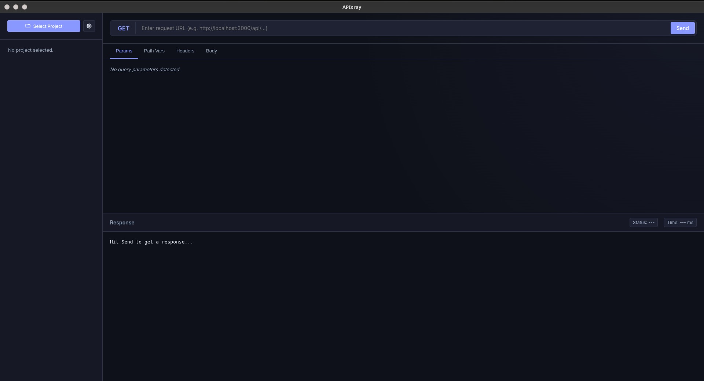
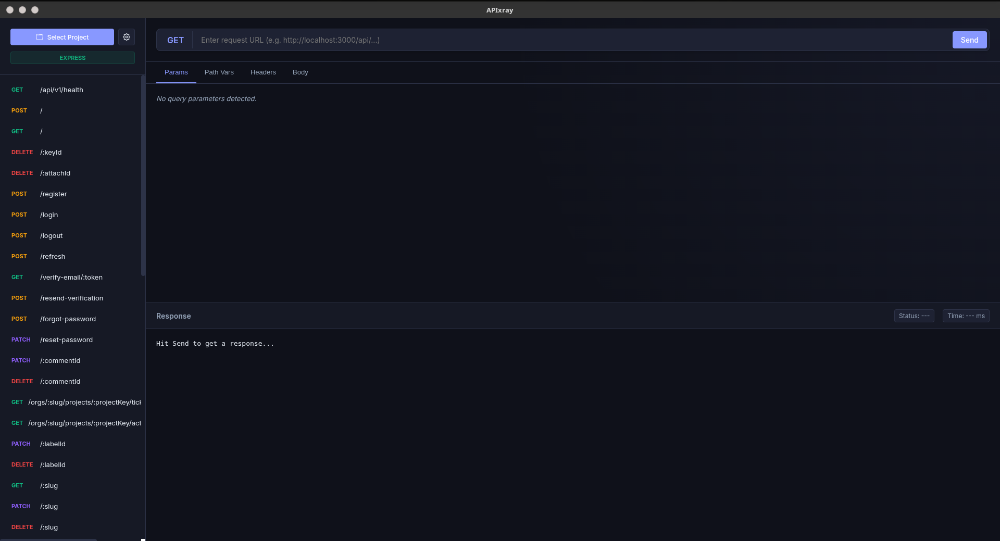
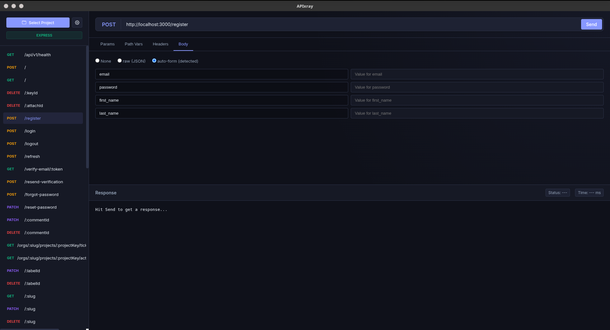
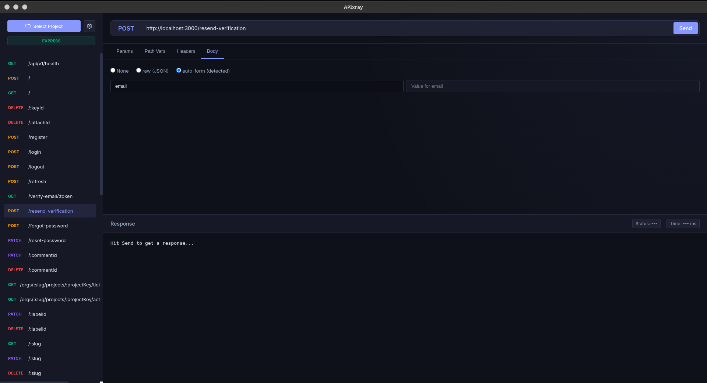
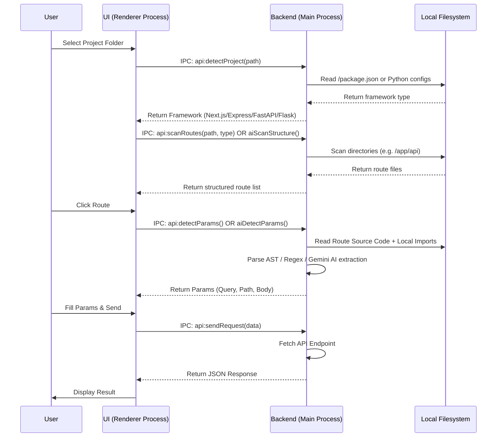
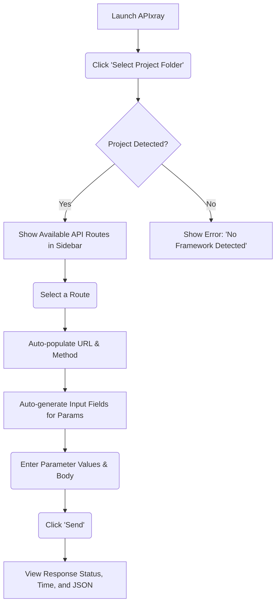

# APIxray

**APIxray** is a modern, fast, Postman-like desktop application built with Electron, Vite, and JavaScript. It automatically scans your backend projects (Next.js, Express, FastAPI, and Flask) to instantly discover API routes and their required parameters (path, query, body), eliminating the need for manual endpoint configuration. 

---

## Screenshots

<p align="center">
  
  
  
  
</p>

---

## Features

- **Multi-Framework Auto-Discovery:** Instant, automatic detection of your backend framework: **Next.js**, **Express**, **FastAPI**, and **Flask**. No tedious manual route configuration required.
- **Hybrid AI Scanning Engine:** Optionally integrate Google Gemini to map complex, non-standard project structures and deeply extract nested query, path, and body parameters with high precision.
- **Smart Parameter Extraction:** Automatically extracts required query parameters, path variables (e.g., `:id`, `{item_id}`, `<int:user_id>`), and body fields (including Pydantic schemas and JSON payloads) using AST/Regex or advanced AI reasoning.
- **Intelligent Port Switching:** Automatically pre-configures standard development ports based on the detected framework (`8000` for FastAPI, `5000` for Flask, `3000` for Next.js/Express).
- **Flexible Request Methods:** Built-in dropdown selector supporting GET, POST, PUT, PATCH, DELETE, HEAD, and OPTIONS HTTP methods.
- **Multi-View Response Display:** View API responses in three formats:
  - **Raw** - Original response exactly as received
  - **JSON** - Pretty-printed and formatted JSON with full syntax highlighting
  - **HTML** - Renders HTML responses in a sandboxed iframe for visual inspection
- **Modern Interface:** Built with Vite and Electron for a snappy, responsive UI.
- **Cross-Platform:** Available for Windows (`.exe` setup) and Linux (`.deb` package).

---

## Architecture Flow

The core mechanism of APIxray involves static code analysis paired with an Electron IPC bridge. Here is how it functions under the hood:



## User Journey Flow



---

## Changelog

### v2.2.0 (Latest)

**New Features:**
- **FastAPI Support:** Automatic discovery of FastAPI routes, APIRouter prefixes, path variables (`{param}`), function signature query params, and Pydantic request models (`BaseModel`).
- **Flask Support:** Full scanning for Flask route decorators (`@app.route`, `@bp.route`, Flask 2.0+ `@app.get/post`), Blueprint URL prefixes, converter path variables (`<int:id>`, `<string:name>`), and `request.args`/`request.get_json()` parameters.
- **Python Project Detection:** Seamless auto-detection via `requirements.txt`, `Pipfile`, `pyproject.toml`, `setup.py`, or root-level framework imports.
- **Optimized Directory Walking:** Smart exclusion of Python virtual environments (`.venv`, `venv`, `env`), cache directories (`__pycache__`, `.pytest_cache`), and build artifacts for blazing-fast scanning.
- **Dynamic Port Assignment:** Automatically sets the default request port to `8000` for FastAPI, `5000` for Flask, and `3000` for Next.js/Express.
- **Python AI Deep Scanning:** Extended Gemini structure scanning and relative Python module import resolution (`from . import ...`, `from .models import ...`) for comprehensive parameter detection.

### v2.1.0

**New Features:**
- Added HTTP method dropdown selector (GET, POST, PUT, PATCH, DELETE, HEAD, OPTIONS)
- Multi-view response display: Raw, JSON, and HTML rendering modes
- HTML responses now render in a sandboxed iframe for safe visual inspection
- Improved response body styling with proper scrolling and padding

**Bug Fixes:**
- Fixed response body text wrapping when content is too large
- Resolved padding and overflow issues in response viewer
- Fixed method selection not persisting when switching between routes
- Improved JSON parsing error handling in response viewer

---

## Downloads & Releases

Pre-compiled binaries are available for Windows and Linux:

- **[Windows (.exe) Setup Installer](https://github.com/MsCoder50/APIxray/releases/latest)**
- **[Linux (.deb) Package](https://github.com/MsCoder50/APIxray/releases/latest)**

---

## How to Use

1. **Launch the App:** Open the APIxray application.
2. **Select Project:** Click the **Select Project Folder** button at the top left.
3. **Choose Folder:** Pick the root directory of your Next.js, Express, FastAPI, or Flask project.
4. **Select a Route:** Click on any of the auto-detected endpoints in the left sidebar.
5. **Fill Parameters:** APIxray will dynamically generate input fields for any Query Parameters, Path Variables, or Body Form fields it detects in your code. Fill them out.
6. **Send Request:** Click **Send** to execute the HTTP request and view the response data in the right-hand panel.

---

## Development & Building from Source

To run APIxray locally or build it for your own platform, follow these steps:

### Prerequisites

- Node.js (v16+)
- npm

### Installation

Clone the repository and install the dependencies:

```bash
git clone https://github.com/MsCoder50/APIxray.git
cd APIxray
npm install
```

### Running Locally

To start the application in development mode with hot-reloading:

```bash
npm start
```

### Building for Production

APIxray uses Electron Forge to create cross-platform executables.

**To build Windows Setup Installer (`.exe`):**
```bash
npm run build:installer
```

**To build for Windows with Electron Forge:**
```bash
npm run make -- --platform=win32
```

**To build for Linux (.deb / .rpm):**
*(Note: Best run on a Linux machine)*
```bash
npm run make -- --platform=linux
```

The compiled binaries will be output to the `out/` directory in your project folder.

---

## Contributing

We welcome contributions! Whether it's adding support for new backend frameworks (like NestJS, Fastify, Django), fixing bugs, or improving the UI.

Please see our [CONTRIBUTING.md](./CONTRIBUTING.md) for details on our code of conduct, and the process for submitting pull requests to us.

## License

This project is licensed under the MIT License - see the [LICENSE.md](./LICENSE.md) file for details.

---
*Created by [MsCoder50](https://github.com/MsCoder50)*
